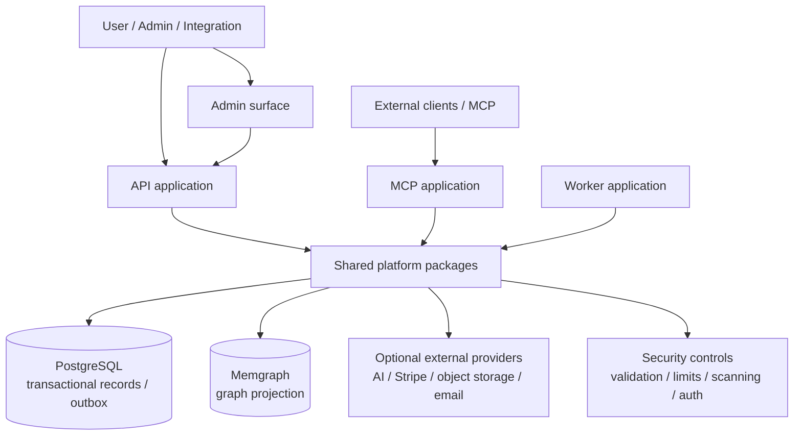

<a id="readme-top"></a>

<div align="center">

# SystemFabric

**A modular Node.js platform foundation for content workflows, commerce, identity, community, and extensible application services.**

[](https://github.com/GoldenObsidianLLC/SystemFabric/actions/workflows/ci.yml)
[](LICENSE)
[](https://nodejs.org/)

[Overview](#overview) · [Capabilities](#capabilities) · [Quick start](#quick-start) · [Architecture](#architecture) · [Documentation](docs/README.md) · [Governance](GOVERNANCE.md) · [Code of Conduct](CODE_OF_CONDUCT.md) · [Contributors](CONTRIBUTOR_RECOGNITION.md) · [Contributing](CONTRIBUTING.md) · [Security](SECURITY.md)

</div>

> **Project status:** SystemFabric 0.5.1 is an actively developed software baseline. It is **not production-certified**. Passing tests and static checks do not replace provider-specific verification, operational rehearsals, an independent security review, or release approval. See [release readiness](docs/RELEASE_READINESS.md).

## Table of contents

- [Overview](#overview)
- [Capabilities](#capabilities)
- [Architecture](#architecture)
- [Technology and components](#technology-and-components)
- [Quick start](#quick-start)
- [Configuration and secrets](#configuration-and-secrets)
- [Testing and validation](#testing-and-validation)
- [Documentation map](#documentation-map)
- [Roadmap and readiness](#roadmap-and-readiness)
- [Contributing](#contributing)
- [Security](#security)
- [License, attribution, and project identity](#license-attribution-and-project-identity)
- [Acknowledgements and documentation inspiration](#acknowledgements-and-documentation-inspiration)

## Overview

SystemFabric is organized as a modular Node.js repository. Its application layer includes API, administration, MCP, plugin-runner, and worker applications. Shared packages provide domain validation, rendering, identity and authentication helpers, AI-provider adapters, data stores, commerce and checkout workflows, community operations, media and cloud adapters, security controls, and related platform services.

The repository aims to make platform behaviors explicit and testable: validate inputs before side effects, bound resource use, fail closed when security-sensitive configuration is missing, keep transactional state in PostgreSQL, and use graph projections for relationship-oriented queries. Provider integrations and operational controls have different maturity levels; consult the test matrix and release-readiness document before relying on any integration in production.

## Capabilities

The codebase contains modules and automated tests for the following areas. This list describes implemented code paths and test coverage, **not a claim that every external provider is configured, every workflow is feature-complete, or the platform is production-ready**.

| Area | What to explore |
|---|---|
| Application surfaces | API, admin, MCP, plugin-runner, and worker applications under `apps/`. |
| Content and rendering | Versioned page-document validation, deterministic rendering, safe HTML handling, draft/preview paths, widgets, and library helpers in `packages/`. |
| AI adapters | Mock and external-provider adapters, structured output validation, bounded inputs/outputs, and fail-closed configuration. |
| Identity and access | Identity helpers, password policy, TOTP/MFA utilities, OIDC/SAML modules, and session/CSRF controls. |
| Commerce | Checkout idempotency, Stripe session orchestration, stock reservations, and reconciliation flows. External provider behavior still requires live test evidence. |
| Persistence and projections | PostgreSQL-backed transactional data and outbox-oriented workflows, with Memgraph graph projection support. |
| Community workflows | Bounded and validated conversation, notification, group, and report workflows. |
| Media and cloud adapters | File-signature validation, quarantining, storage adapters, and malware-scanning interfaces that fail closed when required controls are absent. |
| Plugin safety | Manifest validation, provenance helpers, and explicit allow-listing for isolated execution. A real production sandbox still needs independent validation. |
| Observability and release controls | Audit events, bounded configuration, SBOM artifacts, release-readiness checks, and CI workflows. |

## Architecture

The diagram below is a high-level guide to the repository boundaries, not a deployment specification. Optional services and production topology must be configured and verified independently.



See [Architecture and data flow](docs/ARCHITECTURE.md) for component responsibilities, trust boundaries, and integration notes.

## Technology and components

| Component | Role | Notes |
|---|---|---|
| Node.js | Application runtime | Current supported baseline in project checks: Node.js `>=22.23.4`. |
| npm | Dependency installation and scripts | Prefer `npm ci` for reproducible dependency installation from the lockfile. |
| PostgreSQL | Relational persistence and transactional workflows | Live integration tests use a dedicated `systemfabric_test` database; do not point destructive test setup at production data. |
| Memgraph | Graph projection and relationship-oriented operations | Required for live graph integration tests. |
| EnginEx | Vendored rendering/runtime component | Located at `vendor/enginex/`; consult its own license and notices before modifying or redistributing it separately. |
| GitHub Actions | CI and static analysis | The live workflow badge reflects the latest workflow status, not production certification. |

The authoritative dependency declarations and exact scripts are `package.json`, the lockfile, the code under `apps/` and `packages/`, and `.github/workflows/ci.yml`.

## Quick start

### Prerequisites

- Node.js `>=22.23.4` and npm.
- Git.
- PostgreSQL and Memgraph for live database integration tests.
- Additional credentials or external services only for the specific provider-backed workflows you intend to exercise.

### Install and run the baseline checks

```powershell
git clone https://github.com/GoldenObsidianLLC/SystemFabric.git
Set-Location SystemFabric
npm ci
npm run check
```

`npm run check` runs the repository's artifact/syntax verification and unit tests. It does not, by itself, validate migrations against a fresh database, external provider credentials, production security, load, backup/restore, or every deployment path.

### Additional test suites

```powershell
# Vendored rendering/runtime test suite
npm --prefix vendor/enginex test

# Browser/editor smoke tests (Chromium must be installed)
npm run test:e2e -- --workers=1

# Live PostgreSQL + Memgraph integration suite
npm run test:integration:live

# Dependency audit
npm audit
npm audit --omit=dev
```

The live integration suite expects a dedicated test database named `systemfabric_test`, a reachable PostgreSQL instance, and a reachable Memgraph service. Configure the test environment using the repository's current integration-test configuration and keep test data isolated. Follow [Development setup](docs/DEVELOPMENT.md) and [Testing](docs/TESTING.md) for scope and prerequisites.

## Configuration and secrets

- Never commit `.env` files, real credentials, production dumps, signing keys, or private user data.
- Start from the environment/configuration examples present in the repository; do not invent production values to satisfy a test.
- Use fake fixtures that are visibly non-secret and deterministic. Provider-facing tests should mock transport by default; live provider tests must be explicit and opt-in.
- Scan the current tree and Git history before a public release. Example: `gitleaks dir --redact --verbose .` and `gitleaks git --redact --verbose --log-opts="--all"`.
- If a real credential is exposed, revoke or rotate it first. Editing the current file alone does not erase prior commits.

Read [Security policy](SECURITY.md) before reporting vulnerabilities.

## Testing and validation

| Check | Command | What it does not prove |
|---|---|---|
| Artifact and unit checks | `npm run check` | Does not establish production readiness or validate every live integration. |
| EnginEx | `npm --prefix vendor/enginex test` | Does not certify the whole application. |
| Browser smoke tests | `npm run test:e2e -- --workers=1` | Does not replace manual browser/accessibility acceptance. |
| Live database integration | `npm run test:integration:live` | Does not replace fresh-install, upgrade, backup/restore, or load rehearsals. |
| Dependency audit | `npm audit` | Does not find every code, configuration, or supply-chain risk. |
| Secret scanning | `gitleaks dir ...` and `gitleaks git ...` | A clean scan reduces risk but cannot guarantee that every sensitive-data pattern was detected. |

See [Testing and validation](docs/TESTING.md) for the validation matrix and evidence requirements. Treat CI as authoritative for the commit currently under review; local historical results can become stale after changes.

## Documentation map

Start at **[the documentation index](docs/README.md)**.

| Document | Purpose |
|---|---|
| [Architecture](docs/ARCHITECTURE.md) | Application/package map, data flow, and boundaries. |
| [Development](docs/DEVELOPMENT.md) | Local setup, configuration, and contributor workflow. |
| [Testing](docs/TESTING.md) | Test commands, prerequisites, scope, and validation caveats. |
| [Security](docs/SECURITY.md) | Threat assumptions, secret handling, and security-sensitive controls. |
| [Governance](GOVERNANCE.md) | Project stewardship, decision-making, and funding transparency. |
| [Code of Conduct](CODE_OF_CONDUCT.md) | Community behavior, reporting, and enforcement. |
| [Contributor Recognition](CONTRIBUTOR_RECOGNITION.md) | How project contributions and collaborators are credited. |
| [Release readiness](docs/RELEASE_READINESS.md) | Evidence-based release gates and current certification caveat. |
| [Roadmap](docs/ROADMAP.md) | Staged work grouped by engineering, operations, and release evidence. |
| [Documentation standards](docs/DOCUMENTATION_STANDARDS.md) | How to keep docs concise, accurate, accessible, and maintainable. |
| [Publication checklist](notes/PRE_PUBLICATION_CHECKLIST.md) | Pre-publication review steps. |
| [README inspiration analysis](notes/README_INSPIRATION_ANALYSIS.md) | How the referenced README resources informed this structure. |
| [Changelog](CHANGELOG.md) | Project-level changes recorded by release. |

## Roadmap and readiness

Prioritize verifiable evidence over marketing claims. Outstanding areas include fresh-install and upgrade testing, tenant-isolation review, live identity and provider tests, antivirus integration, browser/accessibility acceptance, commerce/community parity checks, plugin isolation, supply-chain/provenance checks, load and disaster-recovery rehearsals, independent security review, and operational release approval.

The tracked, evidence-based gate list is maintained in [Release readiness](docs/RELEASE_READINESS.md). Do not label the platform production-ready until its required gates have current, reviewable evidence and the release owner explicitly approves the release.

## Contributing

Contributions are welcome. Before opening a pull request:

1. Read [CONTRIBUTING.md](CONTRIBUTING.md) and preserve existing license/copyright notices.
2. Make the smallest focused change that addresses the issue.
3. Run the relevant test suite(s), then `npm run check` when practical.
4. Update docs and tests when behavior or configuration changes.
5. Never include real credentials, personal data, provider responses containing sensitive information, or unreviewed generated artifacts.

Use the GitHub issue templates for bug reports and feature requests, and use the pull request template to describe validation and risk.

## Security

Please do not publish exploitable details or credentials in public issues. Follow [SECURITY.md](SECURITY.md) for private reporting and safe reproduction guidance.

## License, attribution, and project identity

SystemFabric's original project materials are attributed to **Golden Obsidian LLC**, with **Justin Harlan credited as original developer and founder**, subject to the actual ownership and rights applicable to each component. The project is licensed under **GNU GPL version 2 or, at your option, any later version**; see [`LICENSE`](LICENSE), [`COPYRIGHT`](COPYRIGHT), and [`NOTICE.md`](NOTICE.md).

The software license does not grant blanket permission to use the SystemFabric or Golden Obsidian LLC names, logos, crest, or branding to imply official endorsement. See [`TRADEMARKS.md`](TRADEMARKS.md). Third-party and vendored components remain subject to their own applicable license terms.

## Acknowledgements and documentation inspiration

The information architecture of this documentation refresh was informed by:

- [Best-README-Template](https://github.com/othneildrew/Best-README-Template): a navigable README structure, clear project summary, setup/usage flow, roadmap, contribution entry points, license, acknowledgements, and reference-style links.
- [awesome-readme](https://github.com/matiassingers/awesome-readme): examples that emphasize visual hierarchy, screenshots or diagrams where available, useful badges, concise introductions, feature examples, architecture explanations, and links to deeper documentation.

This project uses those as **structural inspiration** and original SystemFabric-specific wording, not as a copied README template. Screenshots, demos, coverage badges, and benchmarks should be added only when the underlying assets or evidence exist.

<p align="right"><a href="#readme-top">Back to top ↑</a></p>
