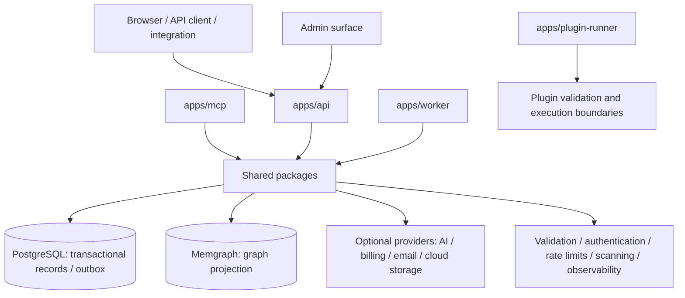

# Architecture and Data Flow

> This is a high-level architectural map based on the current repository layout and its tested code paths. It is not a production deployment blueprint or a guarantee that all integrations are configured in a particular environment.

## Architectural shape

Arrows describe conceptual dependencies, not necessarily synchronous calls or a required deployment topology. The worker, MCP server, and plugin runner have distinct entry points and should be configured with only the permissions and resources they need.

## Applications

| Path | Responsibility to investigate |
|---|---|
| `apps/api/` | HTTP/API routes and composition of platform services. |
| `apps/admin/` | Administration interface and static assets. |
| `apps/mcp/` | MCP integration surface. |
| `apps/plugin-runner/` | Plugin-runner entry point; isolation guarantees must be evaluated for the actual runtime. |
| `apps/worker/` | Background tasks including outbox, scheduling, and mail-related workers. |

Use the source tree and tests as the source of truth; responsibilities can evolve between versions.

## Shared packages

The `packages/` tree separates platform concerns into modules such as AI provider adapters, authentication, billing, commerce, community workflows, persistence, domain schemas, graph projection, library/media storage, notifications, observability, plugins, rendering, security, and widgets. A package's presence is not proof of a deployed integration or an operational service-level objective.

## Persistence and consistency

- **PostgreSQL** is used for relational and transactional workflows, including revision/publication and outbox-related paths.
- **Memgraph** receives graph projection data for relationship-oriented operations. Treat graph state as a projection unless a specific module documents a different source-of-truth contract.
- Outbox and reconciliation workflows are tested for selected retry, idempotency, and concurrency scenarios. A test pass does not replace production load, failure-recovery, and restore exercises.

## External service boundaries

External AI, Stripe, email, object storage, and malware-scanning interfaces may require environment configuration, credentials, SDKs, networking, and provider accounts. Unit tests commonly mock remote calls. A mock-backed test is evidence of local behavior, not proof that the real provider works in production.

Security-sensitive modules should fail closed when required configuration or controls are missing. Do not weaken those checks simply to make a test pass; configure explicit test fixtures or mock the boundary instead.

## Trust boundaries to review

1. Browser/client input entering API routes.
2. Authentication/session identity and authorization checks.
3. Tenant or site scoping before database reads and writes.
4. Media/file uploads before public activation or storage.
5. Plugin metadata, artifacts, and execution environments.
6. Outbound calls to external providers and handling of ambiguous responses.
7. Background jobs consuming outbox, retry, or scheduled work.
8. Secrets, logs, SBOM/provenance, deployment configuration, and build artifacts.

See [Security](SECURITY.md) and [Release readiness](RELEASE_READINESS.md) for expected evidence and remaining review areas.
