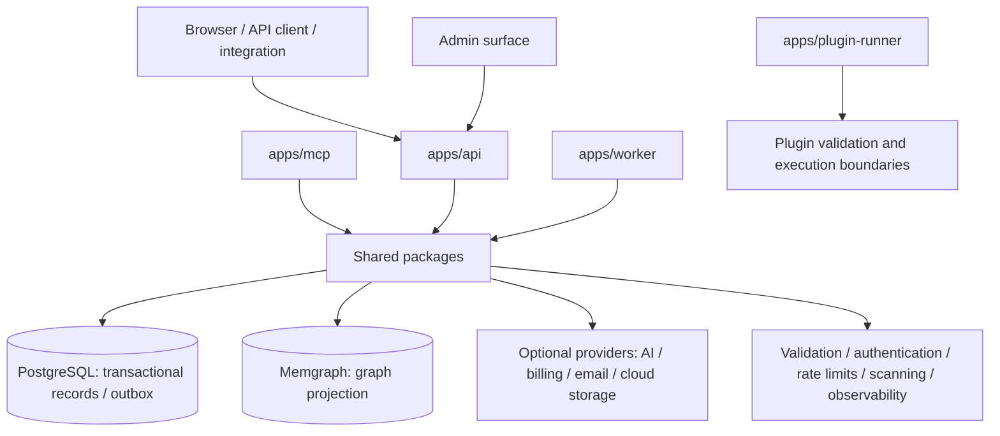

# Architecture and Data Flow

> This is a high-level architectural map based on the current repository layout and its tested code paths. It is not a production deployment blueprint or a guarantee that all integrations are configured in a particular environment.

## Architectural shape



Arrows describe conceptual dependencies, not necessarily synchronous calls or a required deployment topology. The worker, MCP server, and plugin runner have distinct entry points and should be configured with only the permissions and resources they need.

## Applications

| Path | Responsibility to investigate |
|---|---|
| `apps/api/` | HTTP/API routes and composition of platform services. |
| `apps/admin/` | Administration interface and static assets. |
| `apps/mcp/` | MCP integration surface. |
| `apps/plugin-runner/` | Plugin-runner entry point; isolation guarantees must be evaluated for the actual runtime. |
| `apps/worker/` | Background tasks including outbox, scheduling, and mail-related workers. |

Use the source tree and tests as the source of truth; responsibilities can evolve between versions.

## Shared packages

The `packages/` tree separates platform concerns into modules such as AI provider adapters, authentication, billing, commerce, community workflows, persistence, domain schemas, graph projection, library/media storage, notifications, observability, plugins, rendering, security, and widgets. A package's presence is not proof of a deployed integration or an operational service-level objective.

## Contributor map: where to change code

Use this map to find representative source files and tests for a focused contribution. It is not an exhaustive inventory. Check the current code and test imports before making changes.

| Contributor interest | Starting point | Related tests |
|---|---|---|
| API behavior | [`apps/api/src/server.js`](../apps/api/src/server.js), [`platform-routes.js`](../apps/api/src/platform-routes.js) | [`test/api.test.js`](../test/api.test.js) |
| Admin UI and editor | [`apps/admin/`](../apps/admin/) | [`test/e2e/editor.spec.js`](../test/e2e/editor.spec.js), [`test/e2e/accessibility.spec.js`](../test/e2e/accessibility.spec.js) |
| Authentication and authorization | [`packages/auth/src/`](../packages/auth/src/), [`apps/api/src/`](../apps/api/src/) | [`test/auth-security.test.js`](../test/auth-security.test.js), [`test/security-boundaries.test.js`](../test/security-boundaries.test.js) |
| Checkout and billing | [`apps/api/src/platform-routes.js`](../apps/api/src/platform-routes.js), [`packages/billing/src/`](../packages/billing/src/) | [`test/checkout-idempotency.test.js`](../test/checkout-idempotency.test.js), [`test/checkout-reconciliation.test.js`](../test/checkout-reconciliation.test.js) |
| Inventory and stock reservations | [`packages/commerce/src/`](../packages/commerce/src/) | [`test/stock-reservations.test.js`](../test/stock-reservations.test.js), [`test/integration/commerce-reservations.integration.test.js`](../test/integration/commerce-reservations.integration.test.js) |
| Community workflows | [`packages/community/src/`](../packages/community/src/) | [`test/community-workflows.test.js`](../test/community-workflows.test.js), [`test/integration/community-workflows.integration.test.js`](../test/integration/community-workflows.integration.test.js) |
| PostgreSQL and outbox | [`packages/db/src/`](../packages/db/src/), [`apps/worker/`](../apps/worker/) | [`test/integration/postgres.integration.test.js`](../test/integration/postgres.integration.test.js) |
| Memgraph projections | [`packages/graph/src/`](../packages/graph/src/) | [`test/graph.test.js`](../test/graph.test.js), [`test/integration/memgraph.integration.test.js`](../test/integration/memgraph.integration.test.js) |
| AI providers | [`packages/ai/src/`](../packages/ai/src/) | [`test/ai.test.js`](../test/ai.test.js), [`test/providers.test.js`](../test/providers.test.js) |
| Plugin validation and security | [`packages/plugins/src/`](../packages/plugins/src/) | [`test/domain-plugins-media.test.js`](../test/domain-plugins-media.test.js), [`test/security-boundaries.test.js`](../test/security-boundaries.test.js) |

### How to validate a change

Run a focused unit test first, then the repository checks:

```powershell
node --test test/auth-security.test.js
npm run check
```

Choose additional suites based on the affected area:

- Browser changes: run the Playwright end-to-end tests.
- Database changes: run live integration tests against isolated PostgreSQL and Memgraph test resources.
- Provider changes: distinguish mocked unit tests from separate live-provider verification.

The application entry points for MCP and the plugin runner are listed above in **Applications**. This table does not imply that every entry point has a dedicated test.

For setup and validation requirements, see [Contributing](../CONTRIBUTING.md), [Development setup](DEVELOPMENT.md), and [Testing and validation](TESTING.md).

The test links identify representative coverage, not full feature completeness or production certification.

## Persistence and consistency

- **PostgreSQL** is used for relational and transactional workflows, including revision/publication and outbox-related paths.
- **Memgraph** receives graph projection data for relationship-oriented operations. Treat graph state as a projection unless a specific module documents a different source-of-truth contract.
- Outbox and reconciliation workflows are tested for selected retry, idempotency, and concurrency scenarios. A test pass does not replace production load, failure-recovery, and restore exercises.

## External service boundaries

External AI, Stripe, email, object storage, and malware-scanning interfaces may require environment configuration, credentials, SDKs, networking, and provider accounts. Unit tests commonly mock remote calls. A mock-backed test is evidence of local behavior, not proof that the real provider works in production.

Security-sensitive modules should fail closed when required configuration or controls are missing. Do not weaken those checks simply to make a test pass; configure explicit test fixtures or mock the boundary instead.

## Trust boundaries to review

1. Browser/client input entering API routes.
2. Authentication/session identity and authorization checks.
3. Tenant or site scoping before database reads and writes.
4. Media/file uploads before public activation or storage.
5. Plugin metadata, artifacts, and execution environments.
6. Outbound calls to external providers and handling of ambiguous responses.
7. Background jobs consuming outbox, retry, or scheduled work.
8. Secrets, logs, SBOM/provenance, deployment configuration, and build artifacts.

See [Security](SECURITY.md) and [Release readiness](RELEASE_READINESS.md) for expected evidence and remaining review areas.
