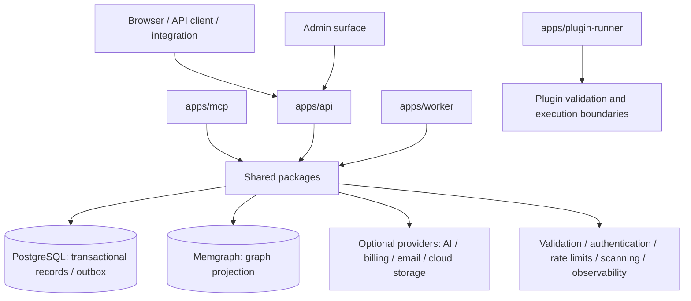

# Architecture and Data Flow

> This is a high-level architectural map based on the current repository layout and its tested code paths. It is not a production deployment blueprint or a guarantee that all integrations are configured in a particular environment.

## Architectural shape



Arrows describe conceptual dependencies, not necessarily synchronous calls or a required deployment topology. The worker, MCP server, and plugin runner have distinct entry points and should be configured with only the permissions and resources they need.

## Applications

| Path | Responsibility to investigate |
|---|---|
| `apps/api/` | HTTP/API routes and composition of platform services. |
| `apps/admin/` | Administration interface and static assets. |
| `apps/mcp/` | MCP integration surface. |
| `apps/plugin-runner/` | Plugin-runner entry point; isolation guarantees must be evaluated for the actual runtime. |
| `apps/worker/` | Background tasks including outbox, scheduling, and mail-related workers. |

Use the source tree and tests as the source of truth; responsibilities can evolve between versions.

## Rendering boundary

The renderer boundary uses EnginEx 7.0.0 through `packages/render`. Its safe restricted grammar and generated renderer remain available; arbitrary JavaScript `<?njs ?>` templates and the `engine-legacy.js` compatibility adapter were removed. Calls to legacy opt-in APIs fail closed; templates must use restricted expressions and narrowly allow-listed helpers.

## API authentication seam

The API composition module keeps responsibility for request lifecycle, identity lookup, session authentication, and the security checks that must run before a route is invoked. Browser authentication route handling is grouped in `apps/api/src/auth-routes.js`: its public handler covers login, MFA verification, password recovery, bootstrap, invitation acceptance, and SAML/OIDC callbacks; its authenticated handler covers account/session and MFA management routes. It receives explicit dependencies (identity, SSO adapters, bounded body readers, rate limiting, response/error helpers) and returns whether it handled the route.

Cookie protocol details live in `apps/api/src/auth-cookies.js`. This module parses cookie headers, validates/serializes the small set of opaque browser auth tokens, and compares the CSRF double-submit pair in constant time. It does not authenticate a session: the API must still look up and validate the server-side token digest. The API server retains the ordering invariant: cookie authentication and same-origin/CSRF checks happen before authenticated auth handlers run. Keep these responsibilities separate when adding routes.

The authentication package composes identity and credential workflows in `packages/auth/src/service.js` while the session persistence/lifecycle seam lives in `packages/auth/src/session-service.js`. The session service receives an explicit pool, clock/TTL settings, token-digest and safe-user functions, and the authorization-invalidation callback. It owns token/CSRF digest persistence, session authentication and membership aggregation, idle/expiry checks, activity touches, CSRF verification, session listing, logout, and revocation. Password, MFA, invitation, federated identity, and site-membership workflows remain in the identity service because their database and authorization transactions cross these concerns. The identity service keeps the same public method surface; `createSession` remains an internal composition operation rather than a new public identity API.

## API route-family seams

The API composition module keeps ownership of request parsing, authentication, site resolution, authorization dispatch, observability, and centralized error handling. Route-family modules receive explicit request-scoped dependencies and return whether they handled the route; they do not independently authenticate a principal or infer a site outside the supplied site-policy function.

- `apps/api/src/auth-routes.js` owns public and authenticated browser-auth route handling; `apps/api/src/auth-cookies.js` owns cookie protocol parsing and serialization.
- `apps/api/src/site-membership-routes.js` owns site member listing/addition/removal and invitation creation. It receives the authenticated actor, the existing `site:manage` capability guard, bounded body reader, identity service, and response helpers; it never performs authentication, chooses a tenant, or writes invitation tokens to audit metadata. `test/site-membership-routes.test.js` covers dispatch, capability-before-persistence ordering, audit content, and invitation secret handling; `test/integration/tenant-membership-administration-isolation.integration.test.js` remains the live cross-site invariant suite.
- `apps/api/src/platform-routes.js` composes the remaining platform-facing route families, including community workflows, firewall, cloud connections, and navigation. It delegates the site-scoped library/media family to `apps/api/src/library-routes.js`.
- `apps/api/src/commerce-routes.js` owns product, order, refund, checkout, and membership routes. Its interface accepts the authenticated actor, `siteIdFor`, `requireCapability`, bounded body reader, response/error helpers, PostgreSQL pool, environment, and identity audit dependency. Queries remain site-scoped, and existing transaction, inventory, idempotency, and Stripe flows remain in their existing code paths.
- `apps/api/src/library-routes.js` owns site-scoped library/media HTTP handling: asset list/upload, metadata and optimistic-version operations, version history, private downloads, and optional media optimization. It receives the authenticated actor, site/capability guards, bounded body reader, response/error helpers, PostgreSQL availability, library store, identity audit dependency, and configured body/optimizer limits. It does not authenticate users or infer site scope. Private download headers, audit minimization, and route behavior are covered by `test/library-routes.test.js`; tenant object isolation remains covered by `test/integration/tenant-library-media-isolation.integration.test.js`.
- `apps/api/src/content-type-routes.js` owns Git/admin custom content-type registry resolution and site-scoped record list/create/detail handling. Git-managed definitions are cached for the API process lifetime and remain authoritative over conflicting admin definitions. Admin definition writes use the shared `withTransaction` helper and a site/slug advisory transaction lock to increment the version and atomically deactivate/replace the prior definition. The API composition layer still authenticates, resolves site scope and supplies `site:manage`, `content:create`, and the shared content-read scope callback also used by legacy page/revision reads. This module validates bounded bodies/field values, applies the supplied policy before registry or record reads, passes the actor ID to `listContent` for own-only filtering, and uses the store's `getByIdForOwner` query for own-only detail reads. `test/content-type-routes.test.js` covers definition precedence, transactional versioning/rollback, validation and side-effect order; `test/api.test.js` exercises the composition path.
- `apps/api/src/request-validation.js` provides bounded JSON-object validation with UTF-8 byte limits and fail-closed serialization handling. UUID validation reuses `packages/domain/src/identifiers.js` rather than introducing another route-local regular expression.

Keep authentication, site-scope checks, and capability checks in their established order. A route-family module must not widen its own authority or bypass the supplied policy functions. The extraction is an internal refactor; it does not change the HTTP route contract or introduce a database migration.

## API AI task route seam

The authenticated read-side AI task endpoints (`GET /api/v1/ai/status`, `GET /api/v1/ai/tasks`, and `GET /api/v1/ai/tasks/:id`) are composed by `apps/api/src/ai-task-routes.js`. Its small injected interface provides the task store, provider information, a site-capability callback, and central response/error helpers. The API server authenticates requests before dispatch, resolves the selected site, and enforces `ai:use`; this module does not authenticate principals or infer tenant scope. Pagination cursors bind the site, actor, status, task type, creation time, and task ID so cursors cannot be replayed across principals, sites, or filter sets.

AI provider generation, saved-page context assembly, site AI policy changes, and queue enqueue/worker composition remain in the API composition module. Extract those workflows separately only after their authorization, policy, cancellation, provider, and persistence contracts have a clear seam.

## Shared packages

The `packages/` tree separates platform concerns into modules such as AI provider adapters, authentication, billing, commerce, community workflows, persistence, domain schemas, graph projection, library/media storage, notifications, observability, plugins, rendering, security, and widgets. A package's presence is not proof of a deployed integration or an operational service-level objective.

## Contributor map: where to change code

Use this map to find representative source files and tests for a focused contribution. It is not an exhaustive inventory. Check the current code and test imports before making changes.

| Contributor interest | Starting point | Related tests |
|---|---|---|
| API composition and request lifecycle | [`apps/api/src/server.js`](../apps/api/src/server.js), [`platform-routes.js`](../apps/api/src/platform-routes.js) | [`test/api.test.js`](../test/api.test.js), [`test/tenant-route-capabilities.test.js`](../test/tenant-route-capabilities.test.js) |
| Commerce and membership HTTP routes | [`apps/api/src/commerce-routes.js`](../apps/api/src/commerce-routes.js), [`request-validation.js`](../apps/api/src/request-validation.js) | [`test/commerce-routes.test.js`](../test/commerce-routes.test.js), [`test/request-validation.test.js`](../test/request-validation.test.js), [`test/checkout-idempotency.test.js`](../test/checkout-idempotency.test.js), [`test/checkout-reconciliation.test.js`](../test/checkout-reconciliation.test.js) |
| Library and media HTTP routes | [`apps/api/src/library-routes.js`](../apps/api/src/library-routes.js), [`packages/library/src/file-store.js`](../packages/library/src/file-store.js) | [`test/library-routes.test.js`](../test/library-routes.test.js), [`test/integration/tenant-library-media-isolation.integration.test.js`](../test/integration/tenant-library-media-isolation.integration.test.js) |
| AI task status and history routes | [`apps/api/src/ai-task-routes.js`](../apps/api/src/ai-task-routes.js) | [`test/ai-task-routes.test.js`](../test/ai-task-routes.test.js), [`test/api.test.js`](../test/api.test.js) |
| Browser authentication routes and cookie protocol | [`apps/api/src/auth-routes.js`](../apps/api/src/auth-routes.js), [`apps/api/src/auth-cookies.js`](../apps/api/src/auth-cookies.js) | [`test/api.test.js`](../test/api.test.js), [`test/auth-cookies.test.js`](../test/auth-cookies.test.js) |
| Site membership administration and invitations | [`apps/api/src/site-membership-routes.js`](../apps/api/src/site-membership-routes.js) | [`test/site-membership-routes.test.js`](../test/site-membership-routes.test.js), [`test/integration/tenant-membership-administration-isolation.integration.test.js`](../test/integration/tenant-membership-administration-isolation.integration.test.js) |
| Custom content-type registry and records | [`apps/api/src/content-type-routes.js`](../apps/api/src/content-type-routes.js), [`packages/domain/src/content-types.js`](../packages/domain/src/content-types.js), [`packages/db/src/transaction.js`](../packages/db/src/transaction.js) | [`test/content-type-routes.test.js`](../test/content-type-routes.test.js), [`test/api.test.js`](../test/api.test.js), [`test/content-owner-store.test.js`](../test/content-owner-store.test.js) |
| Admin UI and editor | [`apps/admin/`](../apps/admin/) | [`test/e2e/editor.spec.js`](../test/e2e/editor.spec.js), [`test/e2e/accessibility.spec.js`](../test/e2e/accessibility.spec.js) |
| Authentication, identity and session persistence | [`packages/auth/src/service.js`](../packages/auth/src/service.js), [`packages/auth/src/session-service.js`](../packages/auth/src/session-service.js) | [`test/auth-security.test.js`](../test/auth-security.test.js), [`test/session-service.test.js`](../test/session-service.test.js), [`test/security-boundaries.test.js`](../test/security-boundaries.test.js) |
| Checkout and billing | [`apps/api/src/commerce-routes.js`](../apps/api/src/commerce-routes.js), [`packages/billing/src/`](../packages/billing/src/) | [`test/commerce-routes.test.js`](../test/commerce-routes.test.js), [`test/checkout-idempotency.test.js`](../test/checkout-idempotency.test.js), [`test/checkout-reconciliation.test.js`](../test/checkout-reconciliation.test.js) |
| Inventory and stock reservations | [`packages/commerce/src/`](../packages/commerce/src/) | [`test/stock-reservations.test.js`](../test/stock-reservations.test.js), [`test/integration/commerce-reservations.integration.test.js`](../test/integration/commerce-reservations.integration.test.js) |
| Community workflows | [`packages/community/src/`](../packages/community/src/) | [`test/community-workflows.test.js`](../test/community-workflows.test.js), [`test/integration/community-workflows.integration.test.js`](../test/integration/community-workflows.integration.test.js) |
| PostgreSQL and outbox | [`packages/db/src/`](../packages/db/src/), [`apps/worker/`](../apps/worker/) | [`test/integration/postgres.integration.test.js`](../test/integration/postgres.integration.test.js) |
| Memgraph projections | [`packages/graph/src/`](../packages/graph/src/) | [`test/graph.test.js`](../test/graph.test.js), [`test/integration/memgraph.integration.test.js`](../test/integration/memgraph.integration.test.js) |
| AI providers | [`packages/ai/src/`](../packages/ai/src/) | [`test/ai.test.js`](../test/ai.test.js), [`test/providers.test.js`](../test/providers.test.js) |
| Plugin validation and security | [`packages/plugins/src/`](../packages/plugins/src/) | [`test/domain-plugins-media.test.js`](../test/domain-plugins-media.test.js), [`test/security-boundaries.test.js`](../test/security-boundaries.test.js) |

### How to validate a change

Run a focused unit test first, then the repository checks:

```powershell
node --test test/auth-security.test.js
npm run check
```

Choose additional suites based on the affected area:

- Browser changes: run the Playwright end-to-end tests.
- Database changes: run live integration tests against isolated PostgreSQL and Memgraph test resources.
- Provider changes: distinguish mocked unit tests from separate live-provider verification.

The application entry points for MCP and the plugin runner are listed above in **Applications**. This table does not imply that every entry point has a dedicated test.

For setup and validation requirements, see [Contributing](../CONTRIBUTING.md), [Development setup](DEVELOPMENT.md), and [Testing and validation](TESTING.md).

The test links identify representative coverage, not full feature completeness or production certification.

## Persistence and consistency

- **PostgreSQL** is used for relational and transactional workflows, including revision/publication and outbox-related paths.
- **Memgraph** receives graph projection data for relationship-oriented operations. Treat graph state as a projection unless a specific module documents a different source-of-truth contract.
- Outbox and reconciliation workflows are tested for selected retry, idempotency, and concurrency scenarios. A test pass does not replace production load, failure-recovery, and restore exercises.

## External service boundaries

External AI, Stripe, email, object storage, and malware-scanning interfaces may require environment configuration, credentials, SDKs, networking, and provider accounts. Unit tests commonly mock remote calls. A mock-backed test is evidence of local behavior, not proof that the real provider works in production.

Security-sensitive modules should fail closed when required configuration or controls are missing. Do not weaken those checks simply to make a test pass; configure explicit test fixtures or mock the boundary instead.

## Trust boundaries to review

1. Browser/client input entering API routes.
2. Authentication/session identity and authorization checks.
3. Tenant or site scoping before database reads and writes.
4. Media/file uploads before public activation or storage.
5. Plugin metadata, artifacts, and execution environments.
6. Outbound calls to external providers and handling of ambiguous responses.
7. Background jobs consuming outbox, retry, or scheduled work.
8. Secrets, logs, SBOM/provenance, deployment configuration, and build artifacts.

See [Security](SECURITY.md) and [Release readiness](RELEASE_READINESS.md) for expected evidence and remaining review areas.
