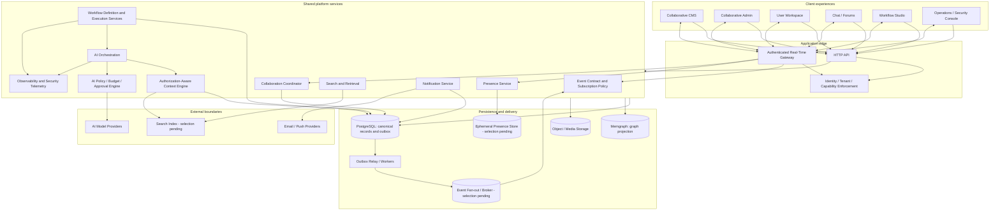
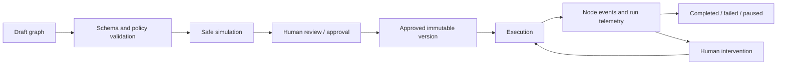

# SystemFabric Real-Time and AI-Native Architecture

**Status:** Proposed architecture for research and staged implementation
**Baseline:** SystemFabric 0.5.1 developer-preview hardening candidate
**Scope:** Real-time events, presence, collaboration, AI orchestration/governance, contextual intelligence and collaborative workflow planning

This document describes a target architecture, not an inventory of currently shipped services. Components and data flows are proposed until implemented and validated. The design must preserve the current platform boundaries: PostgreSQL is authoritative for transactional state, Memgraph is a derived graph projection, and external AI/provider integrations are optional dependencies that require explicit policy and environment validation. It is also guided by the SystemFabric Manifesto: AI should augment human capability and preserve agency, creative dignity and meaningful participation. Those values are engineering goals, not claims of guaranteed economic outcomes.

## 1. Architectural goals

SystemFabric should make real-time collaboration and contextual AI reusable platform capabilities rather than independent features embedded separately in the CMS, admin interface, community, and workflow tools.

The architecture should provide:

1. **One event contract:** durable domain events and ephemeral awareness signals have explicit, distinct semantics.
2. **One authorization model:** every request, subscription, event delivery, AI context lookup and tool action is scoped to the authenticated principal and tenant/site.
3. **One AI governance boundary:** provider adapters are orchestrated through budgets, policies, validation, audit and approval controls.
4. **Composable product services:** CMS, admin, user workspaces, chat, moderation, observability and Workflow Studio consume shared services without becoming tightly coupled to one transport or AI provider.
5. **Graceful degradation:** core CRUD and persisted workflows continue to operate when a real-time transport, broker or AI provider is unavailable.
6. **Evidence before claims:** implementation maturity is established by integration, browser, security, performance and operational evidence, not by interfaces or diagrams alone.

### 1.1 Human-AI symbiosis, agency and consent

The [SystemFabric Manifesto](../SYSTEMFABRIC_MANIFESTO.md) describes the project's mission in terms of economic agency, creative dignity and productive relevance. It states the design thesis that technology should amplify human capability rather than eliminate human necessity, and highlights technological determinism, concentration of power and loss of human agency as concerns. This section translates that thesis into proposed technical constraints; it does not claim that the platform can guarantee employment, income or societal outcomes.

The system should model three distinct participants:

| Participant | Responsibility | Authority boundary |
|---|---|---|
| Human user | Sets goals, provides judgment, makes decisions and owns the consequences assigned to them | Acts within the user's authenticated identity and capabilities; sensitive actions remain subject to policy and approval |
| AI agent | Performs assigned analysis or tasks, generates proposals and executes explicitly delegated operations | Uses a scoped service identity and narrowly delegated capabilities; cannot elevate its own authority, change its own policy or approve its own gated action |
| Collaborative workflow | Coordinates human and AI tasks, state transitions, evidence and approvals | Executes only a validated, versioned definition under the initiating actor's authority and configured policy |

Human oversight must be **proportional to impact**. Do not require a human click for every low-risk, reversible task when an authorized user or administrator has explicitly delegated it. Do require appropriate review for consequential, privileged, externally visible, sensitive or hard-to-reverse actions. Define risk tiers and approval policy per action category, and re-check authorization at execution time.

For AI-assisted experiences:

- Make AI participation visible; distinguish a suggestion, draft, transformation and executed action.
- Allow users to inspect, accept, reject, edit, undo or appeal outcomes where the operation supports those controls.
- Respect user preferences and consent for AI features and contextual data use; provide an understandable explanation of what context is used and by which provider when material.
- Preserve provenance for human and AI contributions where useful to collaboration, accountability or history. Attribution metadata is not, by itself, a legal conclusion about authorship, ownership or compensation.
- Design assistance to build user capability and understanding, not only to maximize throughput.
- Do not use presence, cursor, activity or workflow metrics for covert individual productivity scoring. Define purpose, visibility, access and retention before collecting these signals.
- Offer non-AI or degraded paths when an AI provider is unavailable or a user declines AI assistance, where feasible.

The manifesto's economic-agency goals are a guiding social aspiration. Product functionality may support discoverability, collaboration, skill development and transparent contribution, but must not promise jobs, income, job protection or macroeconomic results.

## 2. Proposed logical architecture



The diagram is conceptual. It does not prescribe a deployment topology, prove that every component exists, or require a separate microservice for every box. Start with clear module boundaries and only split processes where scaling, fault isolation, security or deployment evidence justifies the operational cost.

## 3. Event model: durable events versus ephemeral awareness

These two categories must not be conflated.

### 3.1 Durable domain events

Examples include content published, permission changed, message created, moderation decision recorded, workflow run started and security incident opened.

Requirements:

- The state change and its outbox record are committed atomically in PostgreSQL where the operation is transactional.
- Events have stable IDs and schema versions; consumers are idempotent.
- Delivery is at-least-once unless a stronger, specifically demonstrated guarantee is documented. Consumers must tolerate duplicates.
- Retry, dead-letter, replay and reconciliation behavior is defined and observable. The current PostgreSQL ledger stores per-consumer-group delivery state; replay is available by bounded, explicit event ID selection. Operational observability is not implemented yet.
- Event payloads contain the minimum necessary data. Prefer resource identifiers and authorized follow-up reads over copying sensitive records into broadcasts.
- Ordering is defined only within a documented key or aggregate where required; do not imply global ordering.

### 3.2 Ephemeral awareness and presence

Examples include online/away status, editing a document, cursor location, typing indicator, active AI task state and current workflow canvas selection.

Requirements:

- Presence is lease/TTL based and expires when clients stop heartbeating or disconnect.
- Presence is not the source of truth for messages, content, permissions, approvals or workflow execution.
- Use a purpose-built ephemeral store or equivalent mechanism selected through measurement; avoid high-frequency presence heartbeats becoming hot writes in PostgreSQL.
- Support multiple devices/sessions per user and aggregate state without incorrectly marking a user offline when one device disconnects.
- Respect visibility and privacy preferences. Do not expose sensitive session/device details to ordinary collaborators.
- Reconnection rebuilds awareness from current authorized state, not from assumptions that old transient events were retained.

### 3.3 Suggested event envelope

A versioned envelope could use the following conceptual fields:

```json
{
  "eventId": "00000000-0000-4000-8000-000000000001",
  "eventType": "content.publish",
  "schemaVersion": 1,
  "occurredAt": "2026-01-01T12:00:00.000Z",
  "siteId": "site-id",
  "actor": {
    "type": "user",
    "id": "principal-id"
  },
  "resource": {
    "type": "content",
    "id": "content-id",
    "version": 12
  },
  "correlationId": "request-or-workflow-correlation-id",
  "causationId": null,
  "classification": "site-private",
  "payload": {}
}
```

This v1 envelope is implemented in `packages/realtime/src/event-contract.js`. `siteId` is the current tenancy/isolation boundary; there is not yet a separate `tenantId` in the persistence model. `eventId` is the outbox row primary key, while aggregate/type/version uniqueness is the producer idempotency key. The current schema accepts v1 only, limits payloads to 64 KiB, classifies registered content/relationship/taxonomy domain events as `site-private`, and requires unknown event types to remain `internal` until reviewed. Delivery is at-least-once, not exactly-once; consumers must deduplicate by event identity and use aggregate version to reject stale projections. F1.2 implements PostgreSQL consumer-group delivery rows with independent leases/retries/dead-letter state, per-aggregate ordering and bounded explicit-ID replay in `packages/db/src/outbox-delivery.js`. This ledger is transport-neutral; an external broker and the current Memgraph worker cutover remain pending. See [Real-Time Foundation 1](REALTIME-FOUNDATION-F1.md) for implementation scope and limitations. Do not place access tokens, provider secrets, full prompts, private content or unnecessary personal data in broadcast payloads.

## 4. Real-time gateway and transport

The gateway should authenticate connections and authorize each subscription and event delivery. Authentication at connection time alone is insufficient if permissions can change during a long-lived connection.

Responsibilities:

- Establish identity and tenant/site context from trusted server-side session/token data.
- Validate allowed origins and connection limits.
- Authorize channel/topic subscriptions and re-check or invalidate them when access changes.
- Enforce per-user, per-tenant and per-connection quotas, message size limits and rate limits.
- Apply backpressure and disconnect or degrade abusive/overloaded consumers safely.
- Support reconnect with bounded resume cursors for durable events where retention permits.
- Avoid sending a tenant-wide event to every client and relying on frontend filtering.
- Emit connection, authorization-denial, delivery-lag and saturation telemetry.

Evaluate WebSockets for bidirectional collaboration and server-sent events for one-way event streams. A polling fallback may be appropriate for unsupported networks or low-frequency interfaces. The transport choice should be tested against expected deployment topology, proxy behavior, browser support, reconnect semantics and operational complexity.

The gateway must not become a second authorization system. It delegates to the canonical identity, tenant and capability model.

## 5. Collaboration engine

### 5.1 Initial product scope

Begin with collaborative CMS documents because the current platform already has a versioned structured-document model and editorial workflows.

A collaborative session should support:

- Authorized participants and document-level presence.
- Editing awareness such as cursors/selections where the editor supports it.
- Concurrent change propagation and conflict handling.
- Durable snapshots/revisions and a clear relationship between session changes and persisted document versions.
- Reconnect, offline/temporary network recovery and explicit conflict resolution.
- Comments/review threads with separate permissions and retention rules.
- User-visible attribution and a history that can explain accepted changes.

### 5.2 CRDT versus operational transformation

Do not select a collaboration algorithm solely because it is popular or convenient. Prototype CRDT and operational-transformation approaches against real SystemFabric document structures and editing operations.

Evaluate:

- Nested JSON page documents, rich text, component properties and reorder operations.
- Concurrent edits to the same property and to independent document regions.
- Schema validation and invalid intermediate states.
- Snapshot size, update volume, compaction and long-running sessions.
- Undo/redo semantics, cursor mapping, offline edits and reconnect behavior.
- Server authority, malicious client operations and resource-exhaustion resistance.
- Migration and compatibility across document schema versions.

Persist accepted document state through the existing transactional/versioning model. Transient collaboration operations must not silently bypass schema validation, capability checks, content review or publication workflows.

### 5.3 Admin and user collaboration

Administrative configuration collaboration should follow CMS collaboration only after safe versioned configuration writes, previews, approval rules and audit evidence exist. User workspace collaboration should use privacy-aware activity sharing and explicit user preferences. Do not assume that all user activity should be visible to all collaborators.

## 6. Presence service

Presence is a shared capability used by CMS, admin, chat, forums, Workflow Studio, notifications and AI task interfaces.

Initial state model:

- **Connection:** connected, reconnecting, disconnected.
- **Availability:** active, idle, away, hidden.
- **Activity:** viewing, editing, composing, reviewing, executing, assisting.
- **Scope:** user, site, document, conversation or workflow, each independently authorized.

Design considerations:

- Heartbeats update short-lived leases rather than durable activity history.
- Expiry and cleanup must work after browser crashes, process restarts and network partitions.
- Multi-tab and multi-device behavior should be deterministic.
- Last-active timestamps should be minimized and governed by privacy policy.
- Presence fan-out should be scoped to authorized participants and bounded by room size.
- High-cardinality presence and typing/cursor events require sampling, coalescing or throttling.

Presence categories to build on the shared service:

| Presence | Examples | Main consumers |
|---|---|---|
| User | online, idle, away, active session | Admin, user workspace, community |
| Collaboration | document viewers, editors, cursor/selection awareness | CMS, Workflow Studio |
| Notifications | unread count, pending notification state | All authenticated experiences |
| Chat/forum | typing, active conversation participants, discussion activity | Community |
| AI | queued, working, streaming, awaiting approval, completed, failed | CMS, admin, user workspace, Workflow Studio |
| Observability | service health, queue delay, dependency state, incident status | Operations console |
| Security | sign-in anomalies, policy events, active incident state | Authorized security operators |
| Workflow | active run, node state, paused/awaiting approval | Workflow Studio, admin |

Operational and security presence must be backed by appropriately retained telemetry and strict role-based visibility; they must not broadcast raw logs, secrets or vulnerability details.

## 7. AI orchestration and governance

### 7.1 AI orchestration service

The orchestration layer coordinates provider selection and task execution for writing, translation, search assistance, moderation, diagnostics and workflow planning.

Responsibilities:

- Normalize task requests and provider capabilities.
- Enforce per-tenant and per-user budgets, quotas, timeouts and concurrency limits.
- Support cancellation, retry policies and provider fallback where safe.
- Validate structured outputs against task-specific schemas.
- Record provider/model metadata, policy version, latency, cost estimates and correlation IDs without unnecessarily retaining private prompts or responses.
- Expose a stable application contract so individual product features do not directly depend on one provider SDK.

Provider adapters remain optional boundaries. Core UI and persisted workflows must behave safely when providers are unavailable or return invalid, unsafe or incomplete output.

### 7.2 Authorization-aware context engine

The context engine prepares only information the requesting principal may access.

Required sequence:

1. Authenticate the actor and resolve trusted tenant/site context.
2. Resolve the requested task and required resource scopes.
3. Enforce object-level authorization before retrieving content for model context.
4. Apply data classification, redaction, retention and provider policy.
5. Assemble bounded context with provenance/source references.
6. Re-check authorization before any resulting tool action or state mutation.

Search indexes and graph projections are not substitutes for authorization. They may be stale or contain derived data; every result must be filtered or revalidated against canonical access rules before disclosure or action.

### 7.3 AI policy and approval engine
The policy engine should classify proposed actions by impact and reversibility. A suggested spelling correction differs from publishing a page, changing a user's capabilities, enforcing a firewall rule or suspending a community member. The policy must specify when an operation may execute under a scoped delegation, when confirmation is required, and when an additional reviewer is required. A human approval is meaningful only when the approver is authorized, sees the material consequences and can decline without the AI agent bypassing the decision.

Approval records should bind to the exact action payload or immutable proposal version, target resources, policy version, initiating actor, approver, timestamp and execution result. Revalidate permissions and relevant resource versions when executing; an old approval must not authorize a materially changed proposal.


AI tools should receive narrowly scoped, explicit capabilities for a task. The default posture for sensitive actions is recommendation-only.

Actions requiring stronger control include:

- Publishing or unpublishing content.
- Changing roles, capabilities, identity settings or tenant boundaries.
- Changing firewall, security or rate-limit policy.
- Deleting, exporting or disclosing personal/tenant data.
- Taking moderation actions with material user impact.
- Triggering payments, refunds, billing changes or external communications.
- Executing workflows, plugins, scripts or external tool calls.

For these actions, policy must bind the proposal to an authenticated human approver with the required capability. Approval must cover the specific action payload or version, expire when the proposal changes, be replay-resistant and produce an audit record. AI cannot approve its own proposal or alter the approval policy.

### 7.4 Prompt injection and tool safety

Treat user content, retrieved documents, external pages, model output and workflow definitions as untrusted input. Separate instructions from data, use allow-listed tools with typed schemas, bound outputs and execution time, validate all parameters server-side and prevent tools from receiving ambient credentials or unrestricted network access.

## 8. Initial AI-assisted product capabilities

| Capability | Initial bounded behavior | Required safeguards |
|---|---|---|
| Writing assistant | Grammar/spelling, clarity/coherence suggestions, rewrite, autocomplete and contextual drafting | User initiates or enables assistance; no silent saved edits; accept/reject/undo; privacy and usage controls |
| AI search | Natural-language query and semantic retrieval over authorized resources | Tenant/ACL filtering, deletion/freshness propagation, source references and relevance evaluation |
| Documentation/help/translation | Draft explanations and translations from versioned source material | Source traceability, terminology controls, localization/editor review and no invented product behavior |
| Moderation | Classify and prioritize content for human review | Explainable evidence, policy version, appeal/reversal, bias evaluation and human decision for consequential actions |
| Error reporting/debugging | Summarize redacted exception/trace context and propose diagnostic steps | Secret/PII redaction, least-privilege access, no arbitrary production command execution and operator review |
| Security/firewall assistance | Explain signals and propose policy changes or incident steps | Trusted telemetry, false-positive review, least privilege, human approval and staged rollout |
| Roles/capabilities assistance | Explain effective access and propose least-privilege policy diffs | Canonical capability model, full impact preview, explicit authorized approval and immutable audit |
| UI semantics | Suggest accessible labels, descriptions and semantic relationships | Design-system context, accessibility checks, human review and no automatic claim of WCAG conformance |

## 9. Search, indexing and Memgraph boundaries

Search requires an explicit indexing and authorization design. Evaluate lexical search, PostgreSQL capabilities, dedicated search infrastructure and vector/semantic retrieval based on representative workloads rather than selecting technology prematurely.

Requirements:

- Index only approved content and defined metadata.
- Carry tenant/site and access metadata into index records, but revalidate authorization against canonical data before returning sensitive results.
- Propagate edits, unpublishing, privacy changes and deletion to indexes with measurable freshness objectives.
- Track source IDs, document versions and indexing checkpoints for reconciliation.
- Protect embeddings and derived indexes as potentially sensitive data.

Memgraph remains a graph projection for relationship-oriented use cases. It must not become the authority for permissions, workflow approvals or transactional state unless a future architecture decision explicitly changes the source-of-truth contract and its recovery evidence.

## 10. Workflow Studio architecture

Workflow Studio is a strategic, research-stage capability. Treat it as a typed workflow graph product, not an unrestricted code canvas.

### 10.1 Workflow definition

A workflow definition should be versioned and include:

- A typed node catalog and explicit input/output schemas.
- Edges and conditional branches with validated references.
- Declared capabilities and data scopes for each node.
- Retry, timeout, cancellation and compensation semantics.
- Human approval gates and responsible roles.
- Secret references resolved by the server at execution time, never embedded in exported definitions.
- Creator, editor, version, policy and audit metadata.

### 10.2 Lifecycle



Editing a draft must not mutate an already approved or running version. Runs should reference immutable workflow versions and record per-node inputs/outputs according to data-retention and redaction policy.

### 10.3 Execution safety

Workflow nodes execute through bounded, allow-listed platform actions or separately reviewed isolated workers. No arbitrary code execution is implied by the visual canvas. Enforce CPU, memory, wall-clock, network, filesystem and concurrency limits. External side effects require idempotency keys and explicit compensation/reconciliation design where possible. High-impact actions require the initiating actor's capabilities and any configured human approval at execution time.

AI may draft and explain a workflow, but it may not publish, approve or execute a privileged plan without passing the same validation and authorization process as a human-created plan.

## 11. Observability, security and privacy

Instrument the real-time and AI control planes with structured logs, metrics and traces.

Measure at minimum:

- Active connections, reconnect rates, event delivery latency and fan-out volume.
- Outbox age, retry counts, dead-letter volume and consumer lag.
- Presence lease count, expiry lag and stale-state cleanup.
- Collaboration update rate, conflict frequency, snapshot/compaction cost and session recovery.
- AI queue depth, provider latency/error rate, token/cost usage, validation failures and user feedback.
- Search indexing lag, authorization denials and stale/deleted result incidents.
- Workflow queue/run latency, node failure and retry rates, approval wait time and resource exhaustion events.

Security requirements:

- Reuse existing authentication, tenant/site and capability enforcement; do not trust client-supplied tenant selectors.
- Apply authorization to both subscription establishment and every sensitive event/resource read.
- Use least-privilege credentials for workers and provider adapters.
- Redact credentials, tokens, private prompts and sensitive payloads from logs and traces.
- Define retention, access, export and deletion rules for presence, telemetry, prompts, model outputs and workflow execution data.
- Define consent, user controls, contribution attribution and recourse for AI-assisted outcomes; do not infer consent from a user simply being online or using the platform.
- Prohibit covert productivity scoring based on presence or activity telemetry as a default platform behavior.
- Protect against cross-site event leakage, subscription abuse, replay, message spoofing, prompt injection, model/tool abuse and denial of service.
- Document incident response, key rotation and operational recovery for each production deployment.

## 12. Failure and degradation behavior

| Failure | Required behavior |
|---|---|
| Real-time gateway unavailable | Core HTTP workflows remain usable; clients show degraded/offline state and retry with backoff. |
| Broker/relay unavailable | Durable events remain recoverable through the outbox; alert on lag and dead letters; do not silently mark events delivered. |
| Presence store unavailable | Treat presence as unknown/degraded; do not block durable edits or authorization decisions on presence state. |
| Client disconnect during collaboration | Reconnect and reconcile against server-authoritative document version; expose conflicts rather than silently dropping edits. |
| AI provider unavailable | Return a clear unavailable/queued state; preserve user input; allow retry/cancel and non-AI fallback. |
| AI output invalid or unsafe | Reject or quarantine the proposal; never apply unvalidated tool parameters or content changes. |
| Search index stale/unavailable | Avoid disclosing unauthorized results; expose degraded freshness or use a safe canonical fallback where practical. |
| Workflow worker interruption | Recover from durable run state and idempotency checkpoints; never assume an ambiguous side effect did not happen. |

## 13. Implementation sequence and decision gates

1. **Stabilize the current baseline:** complete the existing tenant isolation, database recovery, provider, browser, accessibility and release-evidence work.
2. **Define contracts:** event envelope, authorization context, AI task lifecycle, policy/approval model and observability conventions.
3. **Prototype real-time delivery:** prove tenant-isolated durable event relay, reconnect, backpressure and multi-instance behavior.
4. **Prototype presence:** prove lease expiry, multiple devices, privacy and failure isolation using an ephemeral store selected by evidence.
5. **Prototype collaborative CMS:** compare CRDT and OT against real document operations and integrate with revisions/recovery.
6. **Integrate the governed writing assistant:** begin with suggestion-only behavior and user-controlled application.
7. **Expand AI platform services:** add search, help/translation, moderation and operational assistance as separate evaluated tasks.
8. **Prototype Workflow Studio:** validate schema, collaboration, simulation and execution threat model before enabling real actions.

Each step requires an architecture decision record where a technology or consistency choice creates long-term coupling. Benchmark and load-test the actual target deployment; do not select a broker, CRDT library, search engine or ephemeral store based only on a diagram.

## 14. Open architecture decisions

| Decision | Options to evaluate | Required evidence |
|---|---|---|
| Real-time transport | WebSocket, SSE, polling fallback, hybrid | Browser/proxy compatibility, latency, reconnect, operations and cost |
| Event fan-out | PostgreSQL-backed relay plus broker, managed event service, other topology | Multi-instance delivery, throughput, ordering scope, retry and recovery |
| Presence store | Redis/Valkey-compatible ephemeral store or another TTL-capable service | TTL behavior, failover, multi-region needs, latency and operational burden |
| Collaboration algorithm | CRDT, OT, hybrid/document-specific strategy | Structured document correctness, conflict semantics, offline/reconnect, memory and update cost |
| Search | PostgreSQL lexical search, dedicated search, vector/hybrid retrieval | Relevance benchmark, tenant filtering, freshness, deletion and operating cost |
| AI provider routing | Explicit provider selection, policy-based routing, fallback strategy | Data policy, model quality, latency, cost, portability and provider failure |
| Workflow execution | Existing worker model, isolated worker pool, sandboxed runtime | Threat model, side-effect recovery, quotas, isolation and auditability |

## 15. Non-goals and explicit boundaries

- This design does not claim that the real-time gateway, presence service, collaborative editing engine, AI orchestration service or Workflow Studio are currently implemented.
- This design does not authorize arbitrary AI-generated code execution or unrestricted plugin/tool access.
- Presence and AI-generated status are not sources of truth for permissions, billing, content publication or workflow outcomes.
- Memgraph is not promoted to the canonical transactional database by this proposal.
- No specific transport, broker, CRDT library, search engine or ephemeral store is selected until the decision gates have evidence.
- Adding an AI feature does not remove the requirement for transparent user control, accessibility, privacy, human accountability and auditability.

## Related documents

- [Feature coverage and strategic capability matrix](FEATURE-PARITY.md)
- [Roadmap](ROADMAP.md)
- [Architecture and data flow](ARCHITECTURE.md)
- [Architecture decisions](ARCHITECTURE-DECISIONS.md)
- [AI integration](AI-INTEGRATION.md)
- [Security model and review boundaries](SECURITY.md)
- [Release readiness](RELEASE_READINESS.md)
- [Research and collaboration](../RESEARCH_COLLABORATION.md)
